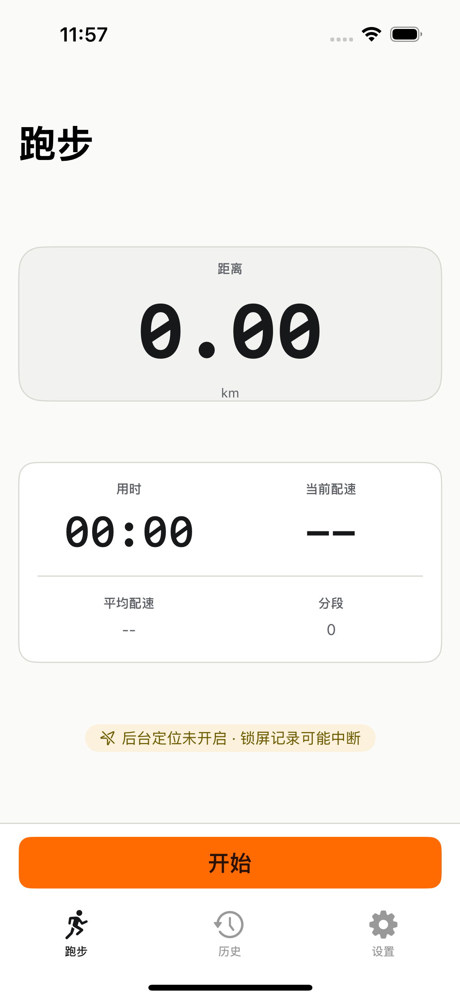
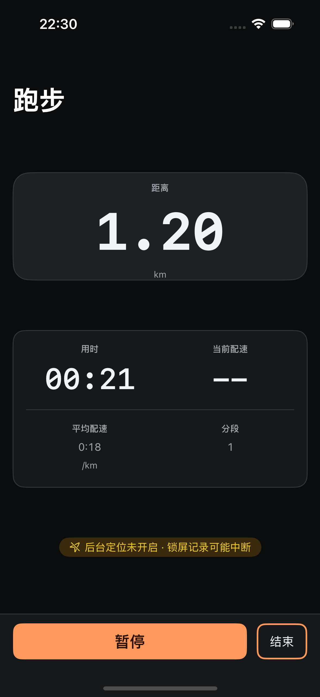
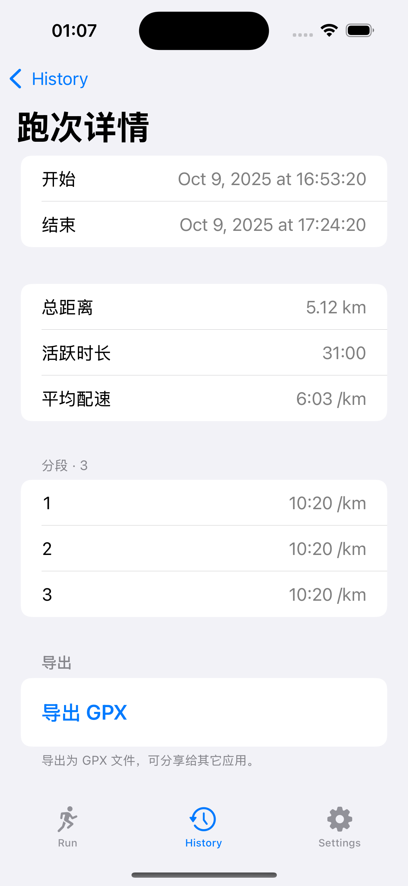

# PurePace

没人打扰你的跑步计时器与热量记录本：无账号、无广告、无社交，数据只留在本机。

当前状态：V1 闭环已实现（一键开跑 → 后台记录 → 每公里语音播报不打断音乐 → 结束保存 → 历史 → GPX 导出/分享）；已过代码层门（[`.munk/code-gates.json`](./.munk/code-gates.json)）与模拟器门（[`.github/workflows/ios.yml`](./.github/workflows/ios.yml)）；真机终验由人按 [`docs/device-manual-acceptance.md`](./docs/device-manual-acceptance.md) 执行，当前尚未发布，版本以根 [`VERSION`](./VERSION) 为唯一真源。交付与候选记录见 [`docs/release/`](./docs/release/)（含双语 release notes 草稿与历史候选记录）。

## 冻结技术栈

| 层 | 选择 |
|---|---|
| iOS | SwiftUI + XCTest/XCUITest，Xcode 26.3 / Swift 6.2 / deployment target iOS 17.0，仅系统框架，无第三方运行时依赖 |
| iOS 工程生成 | XcodeGen 从 `ios/project.yml` 生成；禁止手写 `project.pbxproj` |
| iOS 可测核心 | SwiftPM package `ios/Core`（`swift test` 跑 L1 纯逻辑测试） |
| Android | Gradle wrapper + Jetpack Compose，minSdk 26 / compileSdk 36 / JDK 21；applicationId 集中定义在一处 gradle property |
| Android 测试 | JUnit JVM 单测 + Robolectric 或 Compose UI test |
| Shared | GPX 1.1 / TCX 夹具、字符串占位、SQLite `schema.sql`，只放数据契约 |

禁止引入 RN / Flutter / CMP 等跨端框架。技术栈与目录的分层约定、测试金字塔细则见 [`AGENTS.md`](./AGENTS.md)。

## 版本

版本号的唯一真源是仓库根 [`VERSION`](./VERSION) 文件；README、构建脚本与工程配置一律不写死版本号，需要时通过唯一入口读取：

```bash
bash scripts/version.sh
bash scripts/version.sh --tools
```

`--tools` 在版本号之外追加 Xcode / Swift / JDK / Gradle 版本摘要；工具缺失时该行显式标注「未就绪」，不伪造版本。

## 构建与测试入口

所有入口都在 `scripts/` 下，统一 bash 实现（`set -euo pipefail`、幂等、支持 `--help`、路径以仓库根为基准）：

| 用途 | 入口 | 状态 |
|---|---|---|
| 读取版本号 | `bash scripts/version.sh` | 已就绪 |
| 读取版本号与工具链摘要 | `bash scripts/version.sh --tools` | 已就绪（缺失工具显式标注未就绪） |
| 仓库基线结构断言 | `bash scripts/check-baseline.sh` | 已就绪 |
| iOS 脚本契约断言 | `bash scripts/check-ios-scripts.sh` | 已就绪 |
| iOS 分发归档与导出 | `bash scripts/archive-ios.sh` | 已就绪；`DRY_RUN=1` 脱敏预演，产物仓外并输出 sha256 |
| iOS 分发静态门 | `bash scripts/check-ios-release.sh` | 已就绪；校验归档脚本契约、脱敏、门禁接入与 Runbook |
| iOS 构建 | `bash scripts/build-ios.sh` | 已就绪；无 `ios/PurePace.xcodeproj` 时输出 `blocked:` 并降级 `swift build` |
| iOS 测试 | `bash scripts/test-ios.sh` | 已就绪；无 `ios/PurePace.xcodeproj` 时输出 `blocked:` 并降级 `swift test` |
| Android 构建 | `bash scripts/build-android.sh` | 已就绪；真实执行 `assembleDebug` 并校验非空 APK 产物 |
| Android 测试 | `bash scripts/test-android.sh` | 已就绪；真实执行 `testDebugUnitTest`，区分纯 JVM 与 Robolectric/Compose 两类用例各 ≥1 |
| Android 脚本与结构断言 | `bash scripts/check-android.sh` | 已就绪；含 applicationId 单点、SDK/JDK、版本派生、wrapper 与门禁完整性断言 |

## 跑步链路验收自动化

全链路用例 `PurePaceUITests/RunFlowUITests/testStartFinishExportGPXArtifact` 自动完成「开始 → 结束 → 选中本次记录 → 详情 → 导出 GPX → 系统分享面板 → 回详情」，不依赖人工点击，也不使用固定 sleep。导出产物与跑次 JSON 的机器断言由 `scripts/verify-ios-ui-e2e.sh` 在干净容器上执行；按公司验证分层裁决，这条重 UI E2E 的权威绿是 `ios.yml` 同 commit run（结论必须引真实 run id + headSha），本地 `code_gates` 不再以它阻断：

| 用途 | 入口 |
|---|---|
| 本机定向跑新用例 | `xcodebuild test -project ios/PurePace.xcodeproj -scheme PurePace -destination "platform=iOS Simulator,name=iPhone 16,OS=18.6" -only-testing:PurePaceUITests/RunFlowUITests/testStartFinishExportGPXArtifact CODE_SIGNING_ALLOWED=NO` |
| 干净容器 + 容器级断言（本地可手动跑，非本地阻断门） | `bash scripts/verify-ios-ui-e2e.sh` |
| 真机手测 | 真机验收已改为交付后由人按 `docs/device-manual-acceptance.md` 手测，agent 不再执行 |

证据默认写 `.build/verify-ios-ui-e2e/export-evidence.json`，字段含 `recordId` / `gpxFile` / `sha256` / `trkptCount` / `sampleCount` / `timeSpanSeconds` / `ok`；显式 `--refresh-evidence` 时另复制到 `docs/evidence/stage3-e2e/export-evidence.json`。断言口径：GPX 为 1.1 且可解析、`trkpt` 数 == `samples` 数、时间跨度差与首末时间差均 ≤1s，结论只写「模拟器 + 代码层」。

**人手清单只剩两件**：改系统定位授权、按电源键锁屏。开始 / 结束 / 选记录 / 滚动 / 导出 / 分享全部由用例覆盖。

A 授权遥测 / B 音频机器自证 → 已拆至独立工作项，本项不含。

## 界面语言与截图

- **界面语言**：zh-Hans 单语。App 界面文案只有简体中文一套，没有其他语言的本地化版本。
- **中文截图只进中文正文**：内嵌的中文界面截图只允许出现在本文件的中文正文里。
- **将来新增英文 README 时**：不得内嵌任何 UI 截图，只写一句 `Interface language: Simplified Chinese`，并链到中文图集 `docs/screenshots/`。
- **图集与登记**：截图集在 [`docs/screenshots/`](./docs/screenshots/)，逐文件校验清单为 [`docs/screenshots/SHA256SUMS`](./docs/screenshots/SHA256SUMS)。新增或替换截图必须同步更新该清单：登记文件 sha256（`shasum -a 256 <file>` 实取）与最近改动 commit 全 sha（`git log --format=%H -1 -- <file>` 实取，不许猜），在仓库根用 `shasum -a 256 -c docs/screenshots/SHA256SUMS` 可校验。

以下为界面图集的三张关键屏（完整 14 张：Run 首屏 / 跑步中 / 结束总结 / History 列表 / History 详情 / Settings 六屏浅色与深色 + 结束态丢弃确认浅/深各 1 张，见 `docs/screenshots/`；重出记录与逐图断言见 [`docs/evidence/screenshot-refresh/README.md`](./docs/evidence/screenshot-refresh/README.md)）：







门禁定义在 [`.munk/code-gates.json`](./.munk/code-gates.json)：含 `lint` / `lint-baseline` / `lint-ios-core` / `lint-ios-scripts` / `lint-ios-shell` / `lint-android` / `build-ios-core` / `build-ios` / `build-android` / `test-ios-core` / `test-ios` / `test-android` / `test` / `check-shared`；`test` 真实执行 `scripts/check-baseline.sh`，iOS build/test 在工程不可用时显式 `blocked:` 并降级到 `ios/Core` 的 SwiftPM 命令，Android build/test 经统一脚本真实执行 `assembleDebug` / `testDebugUnitTest`。
